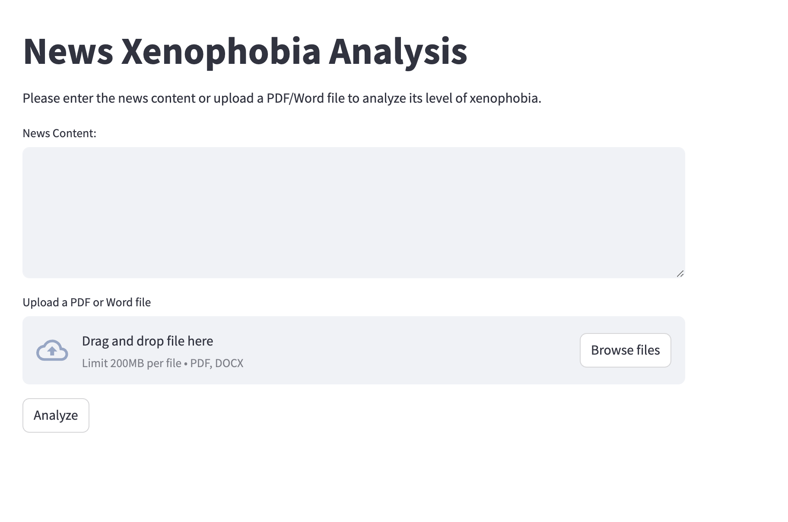

# Media Narrative Analysis

Paste a news article or upload a text-based PDF or DOCX. This Streamlit app flags potentially xenophobic language and shows the model's reason alongside its rating. I built the document handling and connected the app to a Dify workflow for a UNICC-sponsored project at NYU.



## Run locally

Import [the workflow](news-dify-config.yml) into Dify Cloud, configure its model provider and publish it. The app reads the workflow's API key from the `APP_KEY` environment variable. Newer Dify versions may require changes to the original export.

```bash
python3 -m venv .venv
source .venv/bin/activate
python -m pip install -r requirements.txt requests
export APP_KEY='your-dify-workflow-key'
streamlit run demo.py
```

[The app](demo.py) sends the article as `news` and reads `data.outputs.text`. The parser expects `<Classification>` and `<Reason>`. If the response also includes sentiment, category or keywords, the app displays them with the rating.

## Related paper

[Navigating Ethical Challenges in Media: AI Tools for Detecting Harmful Narratives](https://doi.org/10.1109/ISEC64801.2025.11147198), IEEE ISEC 2025. Elaine Zhang, Hillary Liu, Shixuan Lin, Qisong Zhou, Siranush Kostanyan and Andres Fortino.

[Full project, including the chatbot and analysis modules](https://shixuanlin.com/projects/multilingual-content-safety-analysis)
