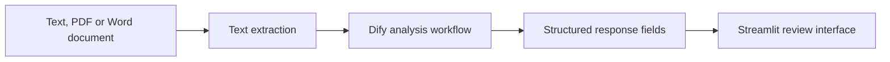

# Media Narrative Analysis

A Streamlit prototype for reviewing news text through narrative flags, explanations, sentiment, topics and keywords.

I developed the document-ingestion pipeline, analytical-workflow integration, structured outputs and application interface during my NYU graduate project work. The project explores how model-based analysis can support people reviewing complex media content.

## Project context

The broader work was undertaken as a UNICC-sponsored NYU applied project and is associated with the co-authored paper **Navigating Ethical Challenges in Media: AI Tools for Detecting Harmful Narratives**, IEEE ISEC 2025.

Elaine Zhang, Hillary Liu, Shixuan Lin, Qisong Zhou, Siranush Kostanyan and Andres Fortino.

[Publication DOI](https://doi.org/10.1109/ISEC64801.2025.11147198) · [Project case study](https://shixuanlin.com/projects/multilingual-content-safety-analysis) · [Personal website](https://shixuanlin.com/)

## Workflow



| Component | What it does |
| --- | --- |
| Input | Accepts pasted text, text-based PDFs and DOCX files |
| Analysis | Sends the extracted text to the configured Dify workflow |
| Output | Presents a xenophobia classification from 1 to 4 with an explanation, sentiment, topic and keywords |
| Interface | Brings the document and analytical output into a common review workflow |

## Development work

I implemented document handling, connected the application to the analysis service, worked on the interfaces between analytical modules, and developed the Streamlit presentation of the resulting fields. A central design concern was keeping a generated label distinguishable from evidence that a reviewer can examine.

This public snapshot contains the Streamlit/Dify interface and workflow layer. The exported workflow specifies `gpt-4o-mini`; the wider project's model-training and evaluation artifacts are separate from this snapshot.

## Repository files

- `demo.py` — the Streamlit application and document-extraction functions.
- `news-dify-config.yml` — the historical Dify workflow export and tagged output format.
- `requirements.txt` — the application's original dependency list.
- `LICENSE` — MIT license.

## Run the snapshot

Create a Python virtual environment and install the dependencies, including `requests`:

```bash
python3 -m venv .venv
source .venv/bin/activate
python -m pip install -r requirements.txt requests
```

Import `news-dify-config.yml` into Dify, configure its model provider and publish the workflow. Create its application API key and set `APP_KEY` in the environment running Streamlit. A newer Dify installation may require migration of this historical export.

```bash
streamlit run demo.py
```

The workflow must accept an input named `news` and expose its analytical result under `data.outputs.text`. The client reads `<Classification>`, `<Reason>`, `<Sentiment>`, `<Category>` and `<Keywords>` tags.

## Interpretation

The application is a research prototype for human review. Its generated labels and explanations do not independently verify facts or determine a moderation action. Model-quality and response-time results need to be read with their matching dataset, configuration and evaluation records.

## More work

[Selected work and portfolio](https://github.com/shixuanlin1/shixuanlin1.github.io) · [GitHub profile](https://github.com/shixuanlin1)
